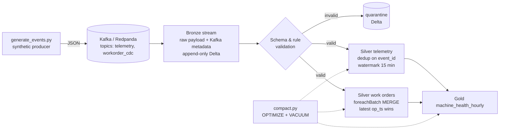

# streaming-lakehouse-cdc

 

Kafka → Spark Structured Streaming → Delta Lake bronze/silver/gold, with idempotent CDC `MERGE`, a quarantine path for bad records, and a compaction job. Everything runs on a laptop.

> Fictional company: **Brazos Sensors**, a manufacturer streaming machine telemetry and work-order changes. All data is synthetic and generated by `scripts/generate_events.py`.

## The problem
Telemetry arrives late, out of order and occasionally twice. Work orders change state (open → in progress → closed) and arrive as change events from an operational database. The analytics team needs:
- a **silver** table that always reflects the latest state of every work order, with no duplicates, even after a replay
- **gold** hourly machine-health aggregates they can trust
- bad records kept out of the way but never silently dropped

## Architecture


## Run it in three commands
```bash
make up      # starts Redpanda + a Spark/Delta container (docker compose)
make demo    # produces 50k synthetic events, runs bronze→silver→gold, prints gold rows
make test    # pytest: unit tests for transforms + an end-to-end replay test
```
Requirements: Docker and about 4 GB RAM. No cloud account needed.

## What is inside
```
src/lakehouse/
  config.py            # paths, topics, checkpoint locations
  schemas.py           # explicit StructTypes, no schema inference in streams
  bronze.py            # Kafka source → append-only Delta with ingestion metadata
  validate.py          # rule checks; invalid rows routed to quarantine with a reason code
  silver_telemetry.py  # watermark + dropDuplicates on event_id
  silver_workorders.py # foreachBatch MERGE: dedupe within batch, apply only newer op_ts, handle deletes
  gold.py              # hourly machine-health aggregates
  compact.py           # OPTIMIZE / ZORDER BY and VACUUM with a retention guard
scripts/generate_events.py  # synthetic producer, with deliberate late, duplicate and malformed events
tests/                      # pytest + local SparkSession fixtures
docs/cost-and-tuning.md     # small files, partitioning vs clustering, trigger intervals, autoscaling
databricks/                 # optional: bundle config (Declarative Automation Bundles, formerly Asset Bundles)
docker-compose.yml · Makefile · .github/workflows/ci.yml · .env.example · LICENSE
```

## Tests
- Transform unit tests (dedupe, out-of-order CDC, deletes, invalid rows)
- **Replay test:** the same batch is processed twice and silver row counts and values must not change (idempotency)
- CI: ruff, pytest

## What it proves
- Streaming ingestion with explicit schemas, watermarks and checkpoints
- CDC applied with `MERGE` in a way that is safe to replay
- Medallion layering with a quarantine path
- File-compaction and cost-tuning reasoning, written down

## Limitations
- Single-node Spark; throughput numbers from a laptop say nothing about production scale.
- Exactly-once delivery is end-to-end only for the Delta sinks (checkpoint + idempotent merge), not for the producer.
- The Databricks bundle is documented but not exercised in CI.

## About the author
Built by Gopi Dodda, Senior Data Engineer: [LinkedIn](https://www.linkedin.com/in/gopidodda6091/). Original work on synthetic data, not derived from any employer or client system.
